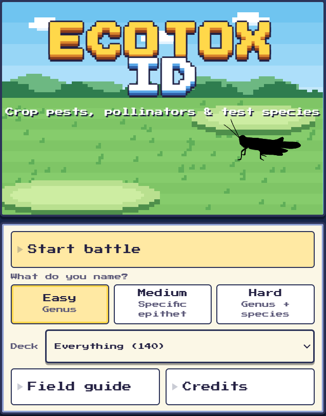
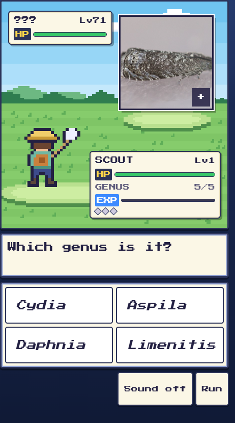

# Ecotox ID

A retro battle-screen game for learning to identify insects, spiders and other wildlife. A real [iNaturalist](https://www.inaturalist.org) photo appears, you pick the scientific name from four choices (six on Hard), and every correct answer wins the round.

**Play it:** (https://revdwd.github.io/ecotox-id-battle/)

**143 organisms to discover:** Meet 140 in the standard battle rotation, plus 3 rare encounters, across crop pests, natural enemies, pollinators, and ecotoxicology test species.

## Screenshots

<p align="center">
  
  
</p>

## How it plays

| Difficulty | You name | Example |
|---|---|---|
| Easy | the genus | *Danaus* |
| Medium | the species (genus shown) | *plexippus* (genus: *Danaus*) |
| Hard | genus and species, from six choices | *Danaus plexippus* (no hints from the genus) |

- Pick one of four answers (six on Hard). Right answers drain the wild organism's HP and earn EXP; a wrong answer costs you 1 of your 5 HP and breaks your streak.
- After 3 correct in a row a **Challenge** round shows only a silhouette. Clear it for bonus points, +2 HP and a step up in difficulty.
- Every organism you meet is added to your **Field guide** (progress is saved in your browser). Use the **Show** menu in the guide to look at one group at a time (butterflies, beetles, spiders and so on).
- Choose from four scout color palettes on the title screen. Your selection is saved on this device.
- Works on phones and desktops, with keyboard play (1-4, or 1-6 on Hard; arrow keys + Enter), and offline once loaded.

The deck has **140 organisms** plus three rare surprises, grouped by role: **crop pests** (caterpillars, beetles, aphids, mites and other pests of corn, soybean, cotton, vegetables and orchards), **natural enemies** (ladybirds, parasitoid wasps, predatory bugs, mites and spiders), **pollinators** (honey bees, bumble bees, native bees, hoverflies) and **test and indicator species** (organisms used in ecotoxicology tests, such as *Daphnia*, *Chironomus* and *Eisenia*). Pick a deck on the title screen, or play everything. After every answer you get a one-line ecotox note about the organism, and the Field guide lists all of its notes. The notes are brief general remarks, not regulatory advice, so check them against primary sources before relying on them. About 40 species also carry a reference to a peer-reviewed paper with Bayer or Monsanto (now Bayer) co-authors, found by PubMed affiliation search; the Field guide links each to its DOI.

**Rare encounter:** an entry marked `"rare": true` in `data/species.json` stays out of the normal rotation and appears in about 1 of 25 battles, with an optional `"intro"` line (the current one is a bombardier beetle, *Brachinus fumans*; also the Varroa mite and a firefly).

**Legendary encounter:** an entry marked `"legendary": true` (the golden soybean looper, honoring the game's creator, DWD) stays in the normal deck but also appears in a gold-glow encounter in about 1 of 65 battles.

**Fun facts:** `data/facts.json` maps a scientific name to concise, engaging "Fun fact:" lines, which the build appends to that species' notes (shown in battle and in the Field guide). Facts aim to connect surprising species behavior to crop protection, beneficial insects, pollinators, or ecotoxicology test organisms; they are educational context, not product claims or regulatory advice. DOI paper references remain separate research notes. New or reviewed facts can include a source URL and ISO review date; cited sources are shown in the Field guide. Existing string facts are retained for compatibility but have no structured provenance yet. Facts are general knowledge and should be reviewed by an expert.

To add a sourced fact, use an object in the species' facts array:

```json
{
  "Danaus plexippus": [
    {
      "text": "Monarch caterpillars feed on milkweed.",
      "source": "https://example.org/verified-reference",
      "reviewedOn": "2026-10-23"
    }
  ]
}
```

Replace the example URL with a source you have checked. `reviewedOn` must be the date the fact and source were last verified.

## Add or remove species (no coding)

1. Sign in at [app.pagescms.org](https://app.pagescms.org) with GitHub and open **ecotox-id-battle**.
2. Edit **Species list**: one scientific name per line, two words, exactly as on iNaturalist (e.g. `Danaus plexippus`).
3. Save. A GitHub Action fetches the photos, silhouettes and look-alike answers, then the site updates in a few minutes (about 20-30 seconds per new species, so a batch of about 25-30 names takes roughly 12 minutes; adding in batches makes a typo easy to find).

If a name can't be found (usually a typo, or iNaturalist renamed the species), the other species are still added, the run in the Actions tab turns red, GitHub emails you, and the log names the species to fix.

Prefer GitHub directly? Edit `data/species.json`, or run the **Build deck** action from the Actions tab (tick *refresh* to re-pick every photo).

## Run locally

Requires Node 20+.

```
npm start            # http://localhost:8123
npm run build-deck   # fetch new photos/silhouettes for species.json
npm run check        # validate the deck, the game rules and the offline file list
```

## Credits

Photos come from iNaturalist observers under Creative Commons licenses; the photographer and license are shown in the game and in the Field guide. Silhouettes come from [PhyloPic](https://www.phylopic.org). Font: Press Start 2P (OFL). Sprites and scenes are original pixel art.

Wild ID is an unaffiliated, non-commercial homage to classic creature-battle games and is not connected to Nintendo, Game Freak or The Pokemon Company.

Developer notes for humans and AI agents: see [AGENTS.md](AGENTS.md).
